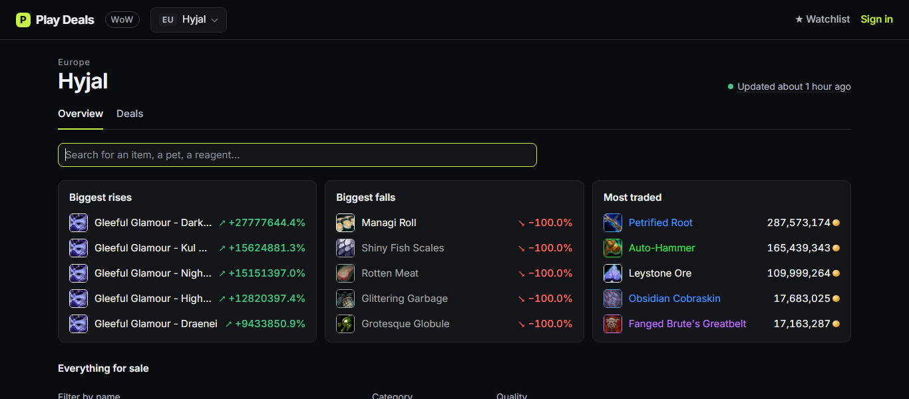
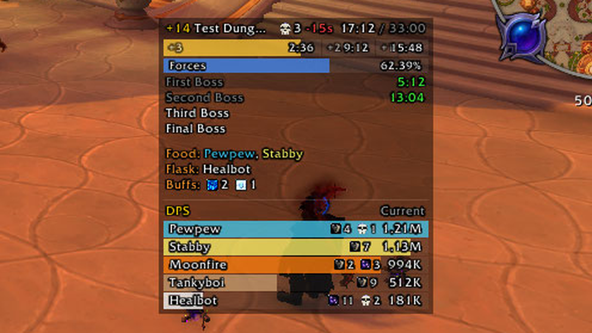

# Primo Ideas

Games and tools, built for fun and shipped for real.

**[primo-ideas.xyz](https://primo-ideas.xyz/)**

[Star Racer](#star-racer) · [Dronoids](#dronoids) · [Play Deals](#play-deals) · [Trading Book](#trading-book) · [Mythic Essentials](#mythic-essentials)

| Project | Play / use it | Source | CI |
| :-- | :-- | :-- | :-- |
| **Star Racer** | [primo-ideas.xyz/star-racer](https://primo-ideas.xyz/star-racer/) | [star-racer](https://github.com/primo-ideas/star-racer) |  |
| **Dronoids** | [primo-ideas.xyz/dronoids](https://primo-ideas.xyz/dronoids/) | [dronoids](https://github.com/primo-ideas/dronoids) |  |
| **Play Deals** | [primo-ideas.xyz/playdeals](https://primo-ideas.xyz/playdeals/) | [playdeals-io](https://github.com/primo-ideas/playdeals-io) |  |
| **Trading Book** | [CurseForge](https://www.curseforge.com/wow/addons/trading-book) | [trading-book](https://github.com/primo-ideas/trading-book) |  |
| **Mythic Essentials** | [GitHub releases](https://github.com/primo-ideas/mythic-essentials/releases/latest) | [mythic-essentials](https://github.com/primo-ideas/mythic-essentials) |  |

---

## Star Racer

Online multiplayer racing through neon cities, up to 8 players per race, right in the browser.

**[▶ Play Star Racer](https://primo-ideas.xyz/star-racer/)**

## Dronoids

A shared, persistent space sector: program your dronoids in a tiny assembly language, grow a central base whose production lines build them, loot relics far out for perks, and hold your corner of space. An account (nickname and password) is needed to play.

**[▶ Play Dronoids](https://primo-ideas.xyz/dronoids/)**

## Play Deals

What things sell for in games: prices, trends and estimated sales. World of Warcraft first, with the biggest rises and falls, most traded items, deals and a watchlist, per realm.

**[↗ Open Play Deals](https://primo-ideas.xyz/playdeals/)**

## Trading Book

World of Warcraft addon that inventories your stock across bags, bank, warband bank, mail and auctions, with its market value.

**[↗ Get Trading Book on CurseForge](https://www.curseforge.com/wow/addons/trading-book)**

## Mythic Essentials

World of Warcraft addon that puts the Mythic+ essentials in one small, clean panel: a DPS meter in class colors with kicks, dispels and deaths, a key timer bar split by chest tier, enemy forces, remaining bosses, and who is missing food, flask or class buffs.

**[↗ Get Mythic Essentials on GitHub](https://github.com/primo-ideas/mythic-essentials/releases/latest)**

