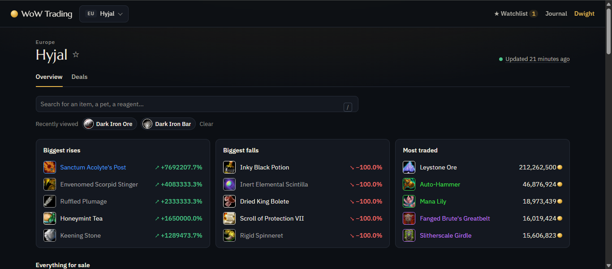
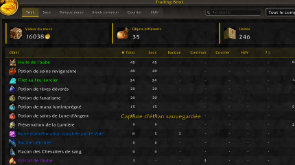

# Primo Ideas

Games and tools, built for fun and shipped for real.

**[primo-ideas.xyz](https://primo-ideas.xyz/)**

[Star Racer](#star-racer) · [Dronoids](#dronoids) · [Ludeal](#ludeal) · [Trading Book](#trading-book)

| Project | Play / use it | Source | CI |
| :-- | :-- | :-- | :-- |
| **Star Racer** | [primo-ideas.xyz/star-racer](https://primo-ideas.xyz/star-racer/) | [star-racer](https://github.com/primo-ideas/star-racer) |  |
| **Dronoids** | [primo-ideas.xyz/dronoids](https://primo-ideas.xyz/dronoids/) | [dronoids](https://github.com/primo-ideas/dronoids) |  |
| **Ludeal** | [primo-ideas.xyz/ludeal](https://primo-ideas.xyz/ludeal/) | [wow-trading](https://github.com/primo-ideas/wow-trading) |  |
| **Trading Book** | [CurseForge](https://www.curseforge.com/wow/addons/trading-book) | [trading-book](https://github.com/primo-ideas/trading-book) |  |

---

## Star Racer

Online multiplayer racing through neon cities, up to 8 players per race, right in the browser.

**[▶ Play Star Racer](https://primo-ideas.xyz/star-racer/)**

## Dronoids

A shared, persistent space sector: program your drone swarms in a tiny assembly language, build factories and colonies, and hold your corner of space.

**[▶ Play Dronoids](https://primo-ideas.xyz/dronoids/)**

## Ludeal

What things sell for in games: prices, trends and estimated sales. World of Warcraft first, with the biggest rises and falls, most traded items, deals and a watchlist, per realm.

**[↗ Open Ludeal](https://primo-ideas.xyz/ludeal/)**

## Trading Book

World of Warcraft addon that inventories your stock across bags, bank, warband bank, mail and auctions, with its market value.

**[↗ Get Trading Book on CurseForge](https://www.curseforge.com/wow/addons/trading-book)**

