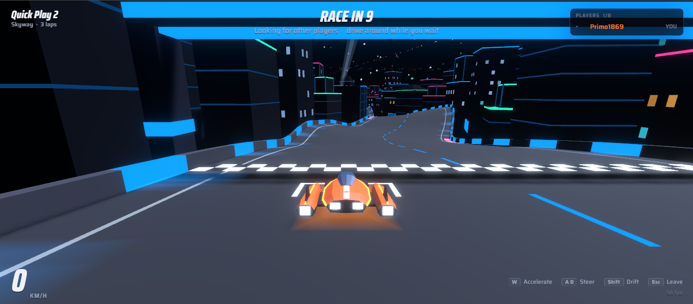
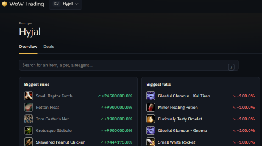

# Primo Ideas

Games and tools, built for fun and shipped for real.

[Dronoids](#dronoids) · [Space Race](#space-race) · [WoW Trading](#wow-trading) · [Trading Book](#trading-book)

| Project | Play / use it | Source | CI |
| :-- | :-- | :-- | :-- |
| **Dronoids** | [primo-ideas.xyz/dronoids](https://primo-ideas.xyz/dronoids/) | [dronoids](https://github.com/primo-ideas/dronoids) |  |
| **Space Race** | [primo-ideas.xyz/space-race](https://primo-ideas.xyz/space-race/) | [star-racer](https://github.com/primo-ideas/star-racer) |  |
| **WoW Trading** | [wow-trading.live](https://wow-trading.live/) | [wow-trading](https://github.com/primo-ideas/wow-trading) |  |
| **Trading Book** | [CurseForge](https://www.curseforge.com/wow/addons/trading-book) | [trading-book](https://github.com/primo-ideas/trading-book) |  |

---

## Dronoids

Program your drone swarms, build factories and colonies, and hold your corner of space.

**[▶ Play Dronoids](https://primo-ideas.xyz/dronoids/)**

## Space Race

Online multiplayer racing through neon cities, up to 8 players per race, right in the browser.

**[▶ Play Space Race](https://primo-ideas.xyz/space-race/)**

## WoW Trading

Auction house tracker for World of Warcraft: biggest rises and falls, most traded items, deals and a watchlist, per realm.

**[↗ Open WoW Trading](https://wow-trading.live/)**

## Trading Book

World of Warcraft addon that inventories your stock across bags, bank, warband bank, mail and auctions, with its market value.

**[↗ Get Trading Book on CurseForge](https://www.curseforge.com/wow/addons/trading-book)**

